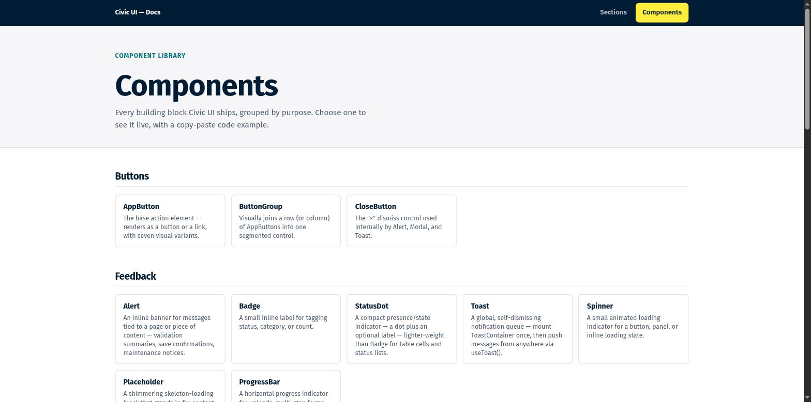

# Civic UI

[](https://github.com/0brick/civic-ui/actions/workflows/ci.yml)
[](https://www.npmjs.com/package/civic-ui)
[](LICENSE)

Accessible Vue 3 components and page sections for public-sector and institutional websites. A calm, high-trust design language (deep navy ink, a strong yellow accent, soft corners, generous whitespace) built entirely on CSS custom properties, so it re-skins without touching a single component.

- **Sections** for a public-facing site: hero, service teasers, FAQ, appointment booking, footer and more.
- **Components** for everything in between: buttons, forms, tables, navigation, overlays, feedback.
- **A webapp kit** (`AppShell`, `Sidebar`, `DataTable`, `StatCard`) so internal tools share the design system of the public site.

[](https://civic.servergedoens.de)

## Built for public-sector requirements

Every component and section is tested against the standards below. The exact requirement lists, in their current versions, are in [`standards/`](standards/README.md).

| Area | Standard |
| --- | --- |
| Accessibility | WCAG 2.2 Level AA, EN 301 549 (V3.2.1 and V4.1.1), BITV 2.0 |
| Privacy | GDPR: zero third-party requests by default, self-hosted fonts, consent before any embed |
| Security | OWASP ASVS 5.0 (frontend requirements), BSI IT-Grundschutz APP.3.1 |

- **Accessible by default.** Real keyboard operability, managed focus for every overlay, correct WAI-ARIA wiring, and form fields that connect label, hint and error text to the control. Every built-in UI text comes from one catalog, with German included: `configureI18n(de)`. See [Accessibility and privacy](docs/accessibility.md).
- **No third-party requests.** Fonts ship inside the package. Videos and maps load only after consent via `ConsentEmbed`.
- **Safe sinks.** Raw SVG props and URL bindings route through one overridable module, so you can wire in your own sanitizer with one call. See [Security](docs/security.md).
- **Accessible theming.** `generatePalette()` takes one brand color (or any set of roles), derives the rest and checks every text and background pairing against WCAG AA. See [Theming](docs/theming.md#color-palette-configuration).
- **Audit your own project.** `npx civic-ui audit --init` once, then `npm run test civic` checks your templates and scripts for WCAG 2.2 AA and security problems. See [Project audit](docs/audit.md).

These are conformance targets the library is tested against, not third-party certifications. [How to verify this yourself](docs/accessibility.md#how-to-verify-this-yourself) lists the free tools to check a deployed site.

## Install

```bash
npm install civic-ui vue
```

```js
// main.js
import { createApp } from 'vue'
import CivicUI from 'civic-ui'
import App from './App.vue'

createApp(App).use(CivicUI).mount('#app')
```

```vue
<template>
  <cui-hero-section title="Welcome" text="Built with Civic UI." />
</template>
```

Or import only what you need:

```vue
<script setup>
import { AppButton, Card } from 'civic-ui'
</script>
```

See [Getting started](docs/getting-started.md) for the full setup.

## Documentation

- [Documentation index](docs/README.md): one page per component and section, with prop tables and examples.
- [Component index](docs/component-index.md): props, slots and dependencies of every component, generated from the source.
- [Playground](https://civic.servergedoens.de): every component and section live, with copy-pasteable code.

## Development

```bash
git clone https://github.com/0brick/civic-ui.git
cd civic-ui
npm install
npm run dev          # playground at http://localhost:5173
```

| Command | What it does |
| --- | --- |
| `npm test` | Unit, accessibility (axe) and style tests |
| `npm run test:a11y-e2e` | The built playground in headless Chromium: axe in light and dark mode, 320px reflow, third-party requests, interaction checks |
| `npm run lint` | ESLint |
| `npm run build:lib` | Library and type declarations into `dist/` |
| `npm run build` | Library and playground |
| `npm run docs:index` | Regenerates `docs/component-index.md` |

Read [CONTRIBUTING.md](CONTRIBUTING.md) before opening a pull request.

## License

[MIT](LICENSE)
